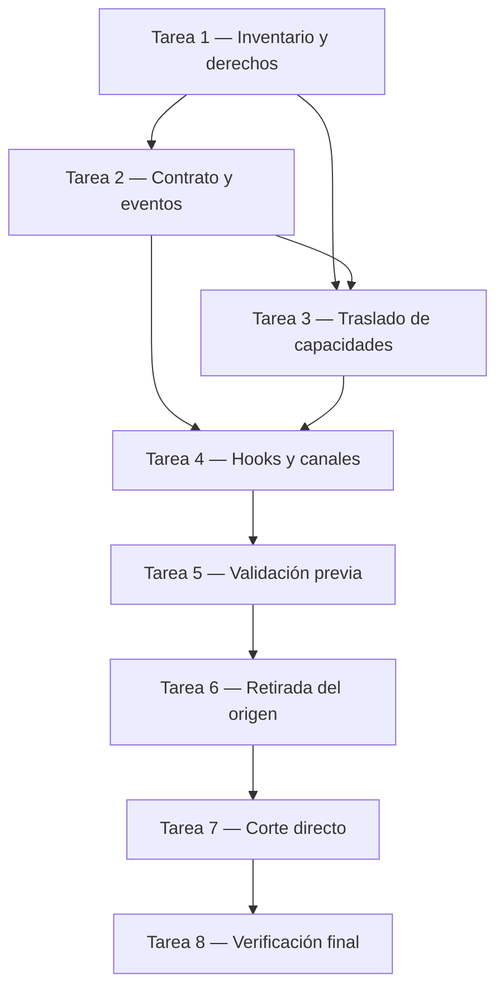

# Plan: migración íntegra de notificaciones de escritorio al plugin

## Contexto del proyecto

El presente documento es un **plan pendiente de ejecución**. No acredita que se haya implementado o probado la migración. Abarca dos repositorios independientes:

- **Plugin**, o `PLUGIN`: `C:/Users/Cristian/Desktop/Proyectos/Voices/Agent-Voice-InterConnector`. Es un plugin TypeScript de Claude Code. Sus hooks se declaran en `hooks/hooks.json`; los bundles de `dist/` se distribuyen junto con el plugin. La narración usa una cola y un worker propios y consume la CLI del motor independiente AI Voice-InterConnector.
- **Orchestrator**, o `ORCH`: `C:/Users/Cristian/Desktop/EvolutiveX/EvolutiveX Agent Orchestrator`. Actualmente los hooks configurados en Claude Code reenvían eventos a `POST /hooks`; `AuditHookEventHandler` combina auditoría y correlación de workflows con la decisión de emitir toasts a través de `node-notifier`.

En adelante, las rutas de las acciones comienzan por `PLUGIN/` u `ORCH/` y son relativas al repositorio correspondiente. Las rutas bajo `~/.claude` y el registro de Windows son **configuración del usuario externa a ambos repositorios**, no archivos de proyecto.

Estado actual y estado buscado:

```text
Actual:    Claude Code → relay → Orchestrator → toast
                           └────→ auditoría y workflows
           Claude Code → plugin → cola de voz → motor de voz

Objetivo:  Claude Code → relay → Orchestrator → auditoría y workflows
           Claude Code → plugin ├─→ toast nativo
                                └─→ cola de voz → motor de voz
```

## Tabla de contenidos

- Contexto del proyecto
- Consideraciones fundamentales para el razonamiento y diseño del plan
- Propósito del plan
- Objetivos del plan
- Fase de ejecución
  - Tarea 1 — Inventario, contratos y derechos
  - Tarea 2 — Contrato del plugin y tabla de eventos
  - Tarea 3 — Traslado del servicio, CLI, registro y assets
  - Tarea 4 — Integración de hooks y canales independientes
  - Tarea 5 — Pruebas, distribución y validación previa al corte
  - Tarea 6 — Retirada íntegra del Orchestrator
  - Tarea 7 — Corte directo y configuración de Windows
  - Tarea 8 — Verificación final y cierre documental
- Dependencias y orden de ejecución
- Fase de cierre

## Consideraciones fundamentales para el razonamiento y diseño del plan

### Alcance y decisiones acordadas

1. Se traslada la **capacidad íntegra**: servicio, formateo, catálogo, CLI manual, gestión de branding Windows, assets, comportamiento relevante y sus pruebas. No queda en `ORCH` un segundo diseño activo, implementación, CLI, ejecutor o dependencia dedicado a los toasts.
2. Se mantiene la cobertura actual de eventos; se aprovechan los campos nativos que el gateway pierde y no se condiciona el toast a encontrar un workflow del gateway. Esto es un **cambio deliberado**: pueden aparecer avisos que antes se omitían y pueden variar sus textos.
3. Se evalúa `node-notifier` como primera opción; su adopción queda condicionada a verificar licencias, empaquetado y funcionamiento real. Si no supera esas condiciones, detener la ejecución y acordar otra opción; no improvisar una alternativa.
4. La CLI de `ORCH/src/2-services/notifications/cli.ts` se traslada y adapta, conservando su funcionalidad y opciones, aunque cambie el comando de entrada. También se traslada la capacidad de consultar, instalar y retirar el registro de Windows.
5. El plugin usa el nombre visible **`Agent-VoiceInterConnector`** y AUMID **`Agent.VoiceInterConnector`**. Usa iconos específicos por evento y toasts silenciosos por defecto. La CLI conserva la capacidad explícita de solicitar sonido.
6. Los canales de voz y escritorio se controlan por separado. El toast no depende de la cola de voz, del motor, de su daemon, de Gemini ni del proxy. La desactivación de uno no desactiva el otro.
7. Se efectúa un **corte directo**, no un despliegue gradual con ambos emisores visibles. Se prepara y prueba el destino antes del corte; durante el cambio se controla que solo exista un emisor visible. Debe existir una ruta de reversión verificable.
8. Se trasladan los iconos por evento existentes tras verificar derechos y usos; solo se retiran del origen cuando ningún consumidor activo los necesita. El registro antiguo `AIAssistant.Proxy` y su acceso directo solo se eliminan **tras verificar la nueva identidad y obtener confirmación expresa del usuario durante la ejecución**.

### Invariantes de seguridad y alcance

- Conservar `POST /hooks`, los relays y el procesamiento necesarios para auditoría, cierre y correlación de workflows, métricas y proyección Kanban. Eliminar un toast no autoriza eliminar efectos no visuales.
- Los hooks del plugin y los de configuración se combinan. No confiar en que uno sustituya al otro ni desinstalar globalmente los hooks de `ORCH`: algunos son necesarios para auditoría. Las sesiones en curso pueden conservar configuración previa; el corte debe incluir su cierre o reinicio controlado.
- Mantener los eventos de voz y su comportamiento actual; `SessionStart` del plugin también realiza el health-check de voz. Un fallo del canal de escritorio no debe impedir ese health-check ni la narración, ni viceversa.
- El contenido de prompts, comandos y respuestas puede llegar al centro de notificaciones. No añadir envío a red; documentar la exposición local y no registrar payloads completos ni claves innecesariamente.
- El plugin está en desarrollo pre-1.0, pero sus usuarios y el Orchestrator pueden depender de comandos y configuración. Documentar los cambios de ruta e instalación. La CLI mantiene sus opciones; no se promete que la ruta anterior siga funcionando.
- `ORCH/package.json` declara GPL-3.0-or-later y `PLUGIN/package.json` MPL-2.0. Verificar titularidad, autorización de traslado, licencias de código, imágenes y binarios de terceros antes de copiar o redistribuir. Si no se acredita el derecho de traslado compatible, **detener** y consultar; no afirmar una conclusión legal no verificada.
- Las specs activas de OpenSpec son contratos: su retirada o modificación requiere el procedimiento vigente del repositorio y verificación. Los archivos históricos bajo `openspec/changes/archive/` y changelogs históricos no son implementaciones activas: preservarlos, salvo autorización expresa y específica.
- Ninguna acción de este plan autoriza borrar registros, accesos directos, archivos de usuario o modificaciones preexistentes sin verificar propiedad y recibir la confirmación indicada. Los comandos de prueba y limpieza deben inspeccionarse antes de ejecutarse.

## Propósito del plan

La presentación de notificaciones de escritorio vive actualmente en el gateway, mientras que la narración de los mismos eventos vive en el plugin, lo que divide una responsabilidad de experiencia local y hace depender los toasts del Orchestrator. Se trasladará íntegramente la capacidad al plugin y se retirará la implementación activa del origen, conservando por separado los relays y la auditoría, para tener una sola implementación y un solo emisor visible sin perder las capacidades manuales y operativas existentes.

## Objetivos del plan

- Establecer el inventario verificable de contratos, consumidores, assets, dependencias y derechos antes de cualquier traslado.
- Preservar las capacidades de CLI y cobertura de eventos, incorporando las decisiones de identidad, iconos, sonido e independencia de canales.
- Verificar distribución y comportamiento del plugin instalado, además de la continuidad de auditoría en el Orchestrator.
- Ejecutar un corte directo con pruebas previas, un emisor visible por evento y reversión definida.
- Eliminar del Orchestrator los componentes y contratos activos de notificaciones trasladados, sin borrar historia ni afectar funciones ajenas.

## Fase de ejecución

### Tarea 1 — Inventario, contratos y derechos

#### Propósito

La funcionalidad está repartida entre código, configuración, assets y contratos de dos repositorios. Se realizará un inventario basado en el estado real de ambos árboles para evitar pérdidas de capacidades, eliminaciones ajenas y copias sin autorización.

#### Objetivos

- Identificar consumidores activos, versiones y estado de los árboles, además de la procedencia y permisos de traslado de cada componente.
- Registrar el inventario y las verificaciones en el sistema de trabajo aprobado para la ejecución, sin modificar historia ni exponer secretos.

#### Acciones

1. **`ORCH/src/2-services/notifications/`** — servicio, `cli.ts`, `register.ts`, helpers de registro, formateo, perfiles e imágenes: inventariar las funciones y opciones efectivamente utilizables y sus importadores.
2. **`ORCH/src/3-operations/audit-hook-event.handler.ts`** — ramas de hooks y `emitToast`: separar cada efecto visual de los efectos de auditoría, workflows, métricas y Kanban que deben permanecer.
3. **`ORCH/src/4-api/composition-root.ts`** — inyección del notificador y branding: identificar las dependencias que se retirarán sin alterar el resto de la composición.
4. **`ORCH/assets/notifications/`** — PNG, ICO y directorio de eventos: identificar cada archivo, su procedencia, licencia y consumidores activos; comprobar además si existen assets de origen no versionados antes de depender de ellos.
5. **`ORCH/package.json` y `ORCH/package-lock.json`** — dependencias y comandos: identificar `node-notifier`, `notifications:register` y cualquier otra dependencia que sea exclusiva de la funcionalidad; no asumir que `commander`, `sharp` o `to-ico` son exclusivos sin comprobarlo.
6. **`ORCH/openspec/specs/desktop-notifications-service/spec.md`, `ORCH/openspec/specs/task-in-progress-notification/spec.md` y `ORCH/openspec/specs/hooks-lifecycle-correlation/spec.md`** — requisitos activos: enumerar los que deben retirarse o modificarse mediante el proceso OpenSpec vigente, preservando lo relativo a auditoría.
7. **`PLUGIN/LICENSE`, `PLUGIN/NOTICE`, `ORCH/LICENSE`, `ORCH/package.json` y licencias de `node-notifier` y sus componentes auxiliares** — derechos y redistribución: verificar autorización y compatibilidad antes de trasladar código, assets o binarios; si la evidencia no es suficiente, detener y consultar.
8. **`PLUGIN/README.md`, `PLUGIN/docs/INTEGRATION.md`, `PLUGIN/build.mjs` y `PLUGIN/package.json`** — distribución, Node y contrato con el motor: identificar los compromisos existentes que se deben conservar o actualizar explícitamente.
9. **`~/.claude/settings.json`, configuración efectiva de Claude Code y estado del plugin instalado** — hooks, plugins y rutas: inspeccionar sin imprimir secretos; registrar qué relays y otros hooks deben permanecer y qué instalaciones requieren actualización.

### Tarea 2 — Contrato del plugin y tabla de eventos

#### Propósito

La cobertura del gateway y la del plugin no son idénticas y algunos campos actuales se pierden en el parser. Se definirá un contrato de destino basado en los payloads nativos para que implementación y pruebas tengan criterios observables.

#### Objetivos

- Especificar los eventos, filtros, campos, fallbacks, límites y diferencias deliberadas respecto al origen.
- Definir cómo se conserva la CLI completa y cómo se controlan de forma independiente escritorio y voz.
- **Reversión:** antes del corte, mantener el emisor del gateway como versión recuperable y no activar el nuevo emisor visible.

#### Acciones

1. **`PLUGIN/hooks/hooks.json`** — hooks existentes: especificar la cobertura visual y de voz, evitando reemplazar el hook `SessionStart` de health-check; usar matchers de tool cuando corresponda y confirmar el esquema de la versión de Claude Code soportada.
2. **`ORCH/src/3-operations/audit-hook-event.handler.ts`** — eventos y filtros: definir como mínimo `UserPromptSubmit`, `PreToolUse` para `AskUserQuestion`, `SubagentStart`, `SubagentStop`, `Stop`, `StopFailure`, `SessionStart`, `SessionEnd`, `PermissionRequest`, `TaskCreated`, `TaskCompleted` y `TaskInProgress` derivado de `PostToolUse`/`TaskUpdate` con estado `in_progress`; mantener `PostToolUseFailure` para auditoría sin inventar un toast nuevo.
3. **[Referencia oficial de hooks de Claude Code](https://code.claude.com/docs/en/hooks)** — payloads y tiempo de ejecución: verificar `last_assistant_message`, `error`, `task_subject`, `tool_input`, rutas de transcript y presupuesto de `SessionEnd`; definir fallback para campos ausentes y no depender del transcript en `Stop` cuando el mensaje nativo esté disponible.
4. **`ORCH/src/2-services/notifications/hook-payload-notification-message.ts`** — formatters: especificar normalización, límites y privacidad, incluyendo `task_subject` y `error` nativos y qué hacer si `TaskUpdate` no contiene subject.
5. **`ORCH/src/2-services/notifications/cli.ts`** — interfaz actual: registrar precedencias y opciones `--event-type`, `--message`, `--title`, `--sound`, `--silent`, `--stdin-json`, `--app-id` e `--icon`, sus incompatibilidades y códigos de salida; definir el nuevo comando del plugin sin prometer la ruta antigua.
6. **`PLUGIN/src/lib/config.ts` y `PLUGIN/src/narrate-ctl.ts`** — configuración y controles: definir persistencia y valores por defecto independientes para escritorio y voz, preservando el significado del control de narración existente y sin almacenar secretos.
7. **`PLUGIN/src/message/static-announcements.ts` y `ORCH/src/2-services/notifications/event-notification-profile.ts`** — canales y catálogo: documentar qué mensajes son visuales o hablados, el icono por evento, los sonidos disponibles para la CLI y el silencio por defecto de los hooks.

### Tarea 3 — Traslado del servicio, CLI, registro y assets

#### Propósito

El destino necesita ser autosuficiente para emitir y administrar toasts sin importar código del Orchestrator. Tras las verificaciones de derechos se trasladarán y adaptarán las capacidades existentes al empaquetado y a la identidad del plugin.

#### Objetivos

- Entregar una sola implementación mantenida en el plugin, con CLI y gestión de identidad equivalentes a las capacidades antiguas.
- Garantizar que el plugin instalado contiene o resuelve de manera explícita todos los recursos necesarios, incluidos binarios y licencias de terceros.
- **Reversión:** conservar una revisión recuperable de ambos repositorios y no borrar aún el registro ni los assets externos del usuario.

#### Acciones

1. **`ORCH/src/2-services/notifications/`** — código inventariado: trasladar al plugin los componentes necesarios para notificación, perfiles, formatters, CLI y registro, solo tras superar la verificación de derechos; adaptar imports y rutas sin depender del árbol de `ORCH` en runtime.
2. **`ORCH/assets/notifications/`** — iconos de evento y branding: trasladar al plugin los assets autorizados y necesarios, adaptando el icono de aplicación a la identidad acordada y comprobando que cada evento resuelve una imagen existente.
3. **`ORCH/src/2-services/notifications/DesktopNotificationAdapter.ts` y `PLUGIN/package.json`** — adaptador: evaluar `node-notifier`, preservar el mapeo `appId` → `appID`, el modo silencioso y la gestión de fallos; añadir la dependencia solo si se valida su redistribución y funcionamiento.
4. **`PLUGIN/build.mjs` y `PLUGIN/dist/`** — distribución: adaptar los bundles y el empaquetado para incluir las dependencias JavaScript, los ejecutables auxiliares y recursos necesarios con rutas válidas desde un clon o instalación limpia; no asumir que esbuild incorpora automáticamente los binarios de `node-notifier`.
5. **`ORCH/src/2-services/notifications/register.ts`, `registry.ts`, `snoretoast-shortcut.ts` y `lnk-format.ts`** — gestión Windows: trasladar y adaptar instalación, estado y desinstalación a `Agent.VoiceInterConnector`, con operaciones explícitas, comprobación idempotente y sin borrar el registro anterior.
6. **`PLUGIN/NOTICE`, licencias de terceros y assets distribuidos** — atribuciones: actualizar y verificar avisos, fuentes y condiciones exigidas por las licencias aprobadas.

### Tarea 4 — Integración de hooks y canales independientes

#### Propósito

El plugin procesa voz en una cola secuencial que puede tardar más de lo adecuado para alertas visuales. Se conectará el canal de escritorio a los hooks sin hacerlo depender del worker, del gateway ni de los servicios de voz.

#### Objetivos

- Garantizar que cada canal toma su decisión por separado y que los fallos son aislados y no bloqueantes.
- Mantener la narración y los efectos de `SessionStart` existentes, añadiendo la cobertura visual acordada.
- **Reversión:** desactivar el canal de escritorio del plugin o volver a la revisión previa antes de restaurar el emisor del gateway.

#### Acciones

1. **`PLUGIN/hooks/hooks.json`** — entradas de eventos: registrar los hooks de escritorio y los matchers especificados, sin eliminar las entradas de voz y sin añadir un hook para cada invocación de herramienta cuando baste un matcher específico.
2. **`PLUGIN/src/narrate-hook.ts`, `PLUGIN/src/narrate-worker.ts` y `PLUGIN/src/lib/queue.ts`** — ruta de voz: conservar la cola de narración y evitar que el toast espere detrás de síntesis o reproducción; mantener intactos los eventos que no necesitan voz.
3. **`PLUGIN/src/lib/hook-payload.ts`** — payload: admitir y validar los campos nativos requeridos, incluyendo `task_subject`, `error`, `tool_name`, `tool_input` y mensajes finales, con fallbacks seguros.
4. **`PLUGIN/src/health-check.ts` y controles del plugin** — inicio y configuración: asegurar que el toast de `SessionStart` y el health-check de voz no se bloqueen mutuamente; comprobar que escritorio activo funciona con voz desactivada y con el motor ausente.
5. **`PLUGIN/hooks/hooks.json` y handler de `SessionEnd`** — cierre: mantener el hook breve y de mejor esfuerzo; verificar el presupuesto real de Claude Code sin prometer entrega garantizada ante terminación abrupta.

### Tarea 5 — Pruebas, distribución y validación previa al corte

#### Propósito

El traslado solo es seguro si se comprueba desde una instalación real y no únicamente desde los árboles de desarrollo. Se validarán el contrato del plugin y la continuidad del gateway antes de cambiar el emisor visible.

#### Objetivos

- Obtener evidencia de cobertura funcional, aislamiento entre canales y funcionamiento del paquete instalado.
- Detectar duplicados y problemas de licencias, recursos o plataforma antes de retirar el origen.
- **Reversión:** si falla cualquier puerta, mantener el emisor antiguo activo y no ejecutar el corte.

#### Acciones

1. **`PLUGIN/tests/`** — pruebas unitarias y de contrato: cubrir cada evento y sus filtros, campos presentes y ausentes, UTF-8, truncamiento, perfiles, CLI completa, retorno de errores y registro Windows con dependencias simuladas.
2. **`PLUGIN/tests/`** — independencia: probar escritorio con voz desactivada, daemon detenido, CLI de voz ausente y proxy apagado; probar voz cuando falla el adaptador visual y verificar que ambos canales juntos no bloquean hooks.
3. **`PLUGIN/build.mjs`, `PLUGIN/package.json` y `PLUGIN/dist/`** — verificación: ejecutar los checks de tipos, build/dist y suite disponibles, después de revisar sus efectos sobre el árbol; confirmar que la instalación limpia no depende de `ORCH`, de sus `node_modules` ni de rutas de desarrollo.
4. **`PLUGIN/hooks/hooks.json` y una sesión de prueba aislada de Claude Code** — pruebas de extremo a extremo: activar únicamente el emisor visual bajo prueba y verificar los eventos, la CLI manual y el comportamiento ante fallos; no activar simultáneamente el emisor visible del gateway.
5. **`PLUGIN` instalado en Windows, macOS y Linux** — validación por plataforma: comprobar iconos, silencio, entrega y recursos de `node-notifier`; en Windows comprobar nombre, AUMID y operaciones de registro. Si no se dispone de una plataforma, dejar su puerta pendiente y no declarar paridad en ella.
6. **`ORCH/tests/3-operations/audit-hook-event.handler.test.ts` y pruebas de integración de hooks** — regresión: preparar las comprobaciones y registrar el resultado de referencia de cierre y correlación de workflows, métricas y Kanban; ejecutar la comparación tras la retirada en Tarea 6 y nuevamente en Tarea 8.
7. **`PLUGIN/SECURITY.md` y `PLUGIN/docs/INTEGRATION.md`** — privacidad y operación: documentar qué texto aparece localmente, los controles, fallbacks, requisitos de cada SO y el carácter separado del motor de voz.

### Tarea 6 — Retirada íntegra del Orchestrator

#### Propósito

Tras comprobar que el destino cubre las capacidades, mantener una segunda implementación activa produciría duplicidad de diseño y ejecución. Se retirarán todos los componentes activos de escritorio del origen, preservando sus funciones no visuales.

#### Objetivos

- Dejar en `ORCH` cero implementación, composición, CLI, assets exclusivos, dependencia exclusiva y contratos activos de emisión de toasts de escritorio.
- Conservar los relays, auditoría, correlación, métricas, Kanban e historial documental.
- **Reversión:** conservar las revisiones coordinadas anteriores de ambos repositorios; restaurar el gateway solo con el canal del plugin desactivado.

#### Acciones

1. **`ORCH/src/3-operations/audit-hook-event.handler.ts`** — tratamiento de hooks: retirar `emitToast`, el enriquecimiento y los formatters usados exclusivamente para toasts, preservando los efectos no visuales y el orden de cierre de workflows.
2. **`ORCH/src/4-api/composition-root.ts`** — composición: retirar la instancia e inyección del adaptador y el branding, conservando la inyección necesaria para auditoría y el resto de operaciones.
3. **`ORCH/src/2-services/notifications/`** — implementación y CLI antiguas: eliminar los archivos trasladados o que hayan quedado exclusivamente asociados a escritorio, después de verificar todos sus importadores; no dejar un wrapper operativo que duplique o dependa del plugin.
4. **`ORCH/assets/notifications/`** — recursos: retirar las copias exclusivas una vez verificados derechos, traslado y ausencia de consumidores activos; conservar cualquier recurso compartido hasta resolver sus usos.
5. **`ORCH/package.json`, `ORCH/package-lock.json` y `ORCH/scripting/help.ts`** — dependencias y comandos: retirar `notifications:register`, `node-notifier` y solo las dependencias comprobadas como exclusivas; sincronizar lockfile y ayuda mediante las herramientas del proyecto.
6. **`ORCH/configs/hooks.json`, `ORCH/scripting/hooks/`, `ORCH/scripting/install/features/hooks.ts` y configuración efectiva de Claude Code** — relays: conservar las entradas necesarias para auditoría y correlación; eliminar únicamente referencias específicas a la implementación visual retirada, sin eliminar hooks ajenos ni entradas enteras por coincidencia de evento.
7. **`ORCH/openspec/specs/desktop-notifications-service/spec.md`, `ORCH/openspec/specs/task-in-progress-notification/spec.md` y `ORCH/openspec/specs/hooks-lifecycle-correlation/spec.md`** — contratos activos: mediante el flujo OpenSpec vigente, retirar o modificar requisitos visuales y conservar los requisitos de lifecycle que siguen vigentes; no editar ni borrar deltas archivados.
8. **`ORCH/tests/`, `ORCH/README.md`, `ORCH/docs/notifications.md`, `ORCH/docs/hooks.md` y `ORCH/scripting/maintenance/verify-config.ts`** — consumidores y documentación activa: retirar o actualizar pruebas, referencias y verificaciones obsoletas, y explicar que la presentación reside en el plugin sin afirmar que el gateway sigue emitiendo toasts.
9. **`ORCH/tests/3-operations/audit-hook-event.handler.test.ts` y pruebas de integración de hooks** — regresión tras la retirada: ejecutar las comprobaciones preparadas en Tarea 5 y contrastar el cierre y correlación de workflows, métricas y Kanban con el resultado de referencia antes de preparar el corte.

### Tarea 7 — Corte directo y configuración de Windows

#### Propósito

Como los hooks de settings y plugins se ejecutan conjuntamente, cambiar solo uno de los repositorios puede producir duplicados o una interrupción. Se desplegarán las versiones preparadas como un corte directo y se verificará la identidad nueva antes de tocar el registro antiguo.

#### Objetivos

- Establecer un solo emisor visual por evento y mantener el relay del gateway operativo.
- Registrar la nueva identidad de Windows y tratar el registro anterior solo bajo confirmación explícita.
- **Reversión:** desactivar el canal visual del plugin, restaurar la versión anterior del gateway y comprobar un único toast; no borrar la identidad antigua como parte de la reversión.

#### Acciones

1. **`PLUGIN` y `ORCH` — versiones preparadas y resultados de Tarea 5**: registrar las revisiones exactas, comprobar las puertas y confirmar que los usuarios y sesiones afectados pueden actualizarse coordinadamente; si no pueden, detener el corte y acordar una estrategia, sin activar ambos emisores visibles.
2. **`PLUGIN` instalado y `ORCH` desplegado** — corte: instalar y habilitar la versión del plugin y desplegar la versión del gateway sin toasts en la misma ventana controlada; reiniciar las sesiones o procesos necesarios y verificar la configuración efectiva, sin retirar los relays de auditoría.
3. **Registro Windows del usuario y acceso directo del nuevo plugin** — identidad: instalar o actualizar explícitamente `Agent.VoiceInterConnector`, verificar nombre, icono y estado con la herramienta trasladada y emitir una prueba real.
4. **Registro Windows `AIAssistant.Proxy` y acceso directo antiguo** — legado externo: inspeccionar propietario y usos, mostrar al usuario los objetos concretos y pedir confirmación en ese momento; solo con autorización retirar los objetos antiguos y conservar evidencia suficiente para restaurarlos. Si no autoriza, informar que queda legado externo, sin tratarlo como código duplicado en repositorios.
5. **`~/.claude/settings.json` y hooks efectivos de sesiones reiniciadas** — coexistencia: verificar que no hay comandos visuales antiguos ni duplicados del plugin y que se conservan los hooks de relay y los hooks ajenos; no aplicar sobrescrituras globales.

### Tarea 8 — Verificación final y cierre documental

#### Propósito

El corte no está completo hasta demostrar tanto la capacidad de destino como la ausencia de implementación activa duplicada en el origen. Se verificarán ambos repositorios, la configuración efectiva y los resultados de las pruebas.

#### Objetivos

- Demostrar que el plugin cubre las capacidades acordadas y que el gateway conserva sus responsabilidades no visuales.
- Demostrar que no quedan rutas activas de toasts en `ORCH` ni duplicación visible por evento; declarar cualquier limitación de plataforma o legado externo pendiente.
- **Reversión:** ante una regresión no aceptable, aplicar la ruta de Tarea 7 y registrar la versión y causa de la reversión.

#### Acciones

1. **`PLUGIN/README.md`, `PLUGIN/docs/INTEGRATION.md`, `PLUGIN/SECURITY.md` y documentación de CLI** — estado final: actualizar instalación, controles independientes, uso manual, identidad, privacidad, recursos y solución de problemas con los comandos realmente implementados.
2. **`ORCH/src/`, `ORCH/scripting/`, `ORCH/configs/`, `ORCH/package.json`, `ORCH/tests/`, `ORCH/docs/` y `ORCH/openspec/specs/`** — ausencia de legado activo: buscar imports, referencias ejecutables, comandos, dependencias y requisitos de escritorio; clasificar coincidencias históricas o negaciones de tests, no borrarlas automáticamente.
3. **`PLUGIN/tests/` y `ORCH/tests/`** — verificación final: ejecutar los checks acordados en ambas bases y registrar resultados y limitaciones; incluir prueba de cada familia de eventos, CLI completa, registro Windows, canales separados y continuidad de auditoría.
4. **Sesión real de Claude Code con configuración efectiva** — observación: verificar un único toast por evento aplicable, voz independiente y procesamiento del relay; repetir con el motor de voz detenido y, para los toasts, con el proxy apagado sin confundir esa prueba con la disponibilidad normal de Claude Code a través del proxy.
5. **`ORCH/openspec/specs/` y `PLUGIN` instalado desde una distribución limpia** — contratos: validar OpenSpec y comprobar que el plugin no usa rutas ni paquetes del Orchestrator; registrar expresamente cualquier plataforma no comprobada.

## Dependencias y orden de ejecución



La numeración es el orden recomendado. La preparación de la retirada del origen puede diseñarse mientras se construye el destino, pero su versión no debe desplegarse antes de que las pruebas del destino hayan pasado. El desarrollo y las pruebas de funciones independientes pueden paralelizarse dentro de cada tarea cuando sus entradas ya estén acordadas. Tarea 6 prepara la versión sin toasts; Tarea 7 coordina su despliegue con la activación del plugin. No se autoriza mantener ambos emisores visibles como etapa gradual.

## Fase de cierre

Al terminar la ejecución, redactar el **Recorrido (walkthrough)** post-ejecución como apertura del mensaje final, en español, con dos componentes en orden: (1) **Proceso seguido** — qué tareas se ejecutaron y en qué orden; (2) **Desviaciones respecto al plan** — toda divergencia entre el plan aprobado y la ejecución real (tareas adaptadas, acciones añadidas u omitidas, archivos o fuentes tocados fuera de las líneas de Acción planificadas, cambios de orden respecto al orden recomendado), cada una con su motivo; o una nota explícita de que la ejecución coincidió con el plan sin desviaciones. Esta fase no tiene Acciones ni produce mutaciones: prescribe el reporte que cierra la ejecución.
